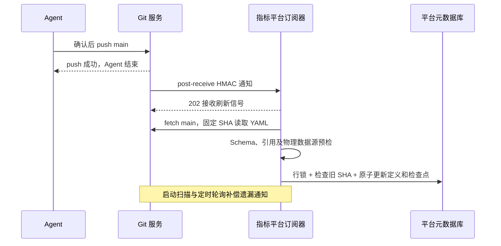

# Git 订阅与 Ossie 定义消费

## 1. 职责和调用链

本功能分为两个部分：

- `metric-git-sync`：独立 Maven library，只负责固定 Git 快照读取、Ossie Schema 校验、Profile 限制及表达式归一化。
- `backend/gitsync`：Spring 装配、Webhook、调度、数据库检查点、平台对象映射与事务发布。查询继续使用现有语义 SQL 编译器。



202 只代表刷新信号进入进程调度队列。任务失败或进程重启后，平台从 Git 当前目标状态恢复。
不依赖 webhook 事件的持久队列，不要求 Agent 轮询平台状态。

## 2. 本次协议边界

固定消费：一个配置仓库、`refs/heads/main`、`semantic/model.yaml`、一个语义模型、一个已有数据源和 schema。
YAML 的 `source` 只能是该 schema 内的物理表或视图名。远端、连接凭据、文件路径、数据源 UUID 不由 YAML 或 webhook 决定。

- Ossie `version: '0.1.1'`；`semantic_model` 恰好一个。
- 模型的 `COMMON` JSON 扩展声明 `data_agent.profile: ossie-metrics` 和整数 `profile_version: 1`。
- 数据集、字段、字段维度属性、指标、关系均通过同一份协议表达；不支持独立顶层 `dimensions`。
- `dimension.is_time: false` 映射普通维度，`true` 映射时间维度；省略 `dimension` 映射度量字段。
- 字段表达式只允许一个物理列；指标引用逻辑 `dataset.field`。
- 指标支持 `SUM / AVG / MIN / MAX / COUNT / COUNT(DISTINCT ...)`；条件只允许单个 `CASE WHEN ... THEN dataset.field END`。
- 固定条件由 AND 连接，支持 `= / <> / != / > / >= / < / <= / IN / NOT IN / IS NULL / IS NOT NULL`，值类型与物理字段匹配。禁止 OR、ELSE、子查询、窗口、任意 SQL、注释和多语句。
- 关系支持单列多对一、`LEFT` 或 `INNER`；目标列必须声明为目标数据集单列 `primary_key`，导入时验证真实唯一性。首版要求两侧规范化类型相同，避免有损数值转换造成聚合膨胀。
- 拒绝未知字段、未知扩展、未知版本、YAML 重复键、锚点、别名、标签、多文档；文件最多 512 KiB。

固定上游 Schema 和来源许可位于 `metric-git-sync/src/main/resources/ossie/`，运行时不下载最新版本。
完整测试示例位于 `metric-git-sync/src/test/resources/model.yaml`。生产仓库应把此结构按真实来源改写为 `semantic/model.yaml`。
协议设计源文档是 Agent 仓库的 `docs/superpowers/specs/2026-09-16-ossie-metric-profile-design.md`，本模块不依赖另一产品实现类。

## 3. 平台映射与查询语义

| 协议对象 | 平台结果 |
| --- | --- |
| dataset | 已配置数据源下的 DatasetEntity |
| field | DatasetFieldEntity，数据类型来自物理元数据 |
| dimension.is_time=false | STANDARD DimensionEntity |
| dimension.is_time=true | TIME DimensionEntity；开放 DAY/WEEK/MONTH/QUARTER/YEAR，默认 DAY |
| metric | MetricEntity，固定条件存为结构化 FilterExpression JSON |
| relationship | DatasetRelationshipEntity 和字段对，保存 join_type |

固定过滤在每个指标自己的聚合表达式内编译为参数化 `CASE WHEN`，不会合并成数据集 WHERE。
`COUNT_DISTINCT` 编译为 `COUNT(DISTINCT ...)`。缺省人工关系继续使用 LEFT。
查询计划读取采用 PostgreSQL REPEATABLE_READ，只在元数据读取阶段持有事务，外部查询执行不占用该事务。
平台暂无原生列可表示的辅助信息保留在成功检查点的完整归一化定义 JSON 中；导入这些信息不等于管理页面已经展示它们。

本次不扩展已有查询 SQL 方言。当前语义编译器沿用反引号标识符，完整指标执行主要面向
既有 StarRocks 查询链路；PostgreSQL 元数据库的事务测试和 JDBC 参数测试不代表已支持
PostgreSQL 作为业务数据源的完整指标查询。接入业务数据源前应使用平台现有查询功能验证兼容性。

## 4. 部署配置

运行环境需安装 Git CLI。先在指标平台建立可用数据源，并准备对应物理表、字段和关系唯一性。
以下配置通过外部配置文件注入，示例不含可直接使用的凭据：

```yaml
metric-platform:
  git-sync:
    enabled: true
    repository-id: metrics
    remote: ${METRIC_GIT_REMOTE}
    executable: git
    cache-directory: ${METRIC_GIT_CACHE_DIRECTORY}
    data-source-id: ${METRIC_GIT_DATA_SOURCE_ID}
    schema: ${METRIC_GIT_SCHEMA}
    model-name: ${METRIC_GIT_MODEL_NAME}
    webhook-secret: ${METRIC_GIT_WEBHOOK_SECRET}
    poll-interval: PT30S
    git-timeout: PT30S
```

`repository-id` 是稳定归属标识（小写字母开头，最多 80 位字母、数字、下划线或连字符）。
`model-name` 必须与 YAML 一致。共享密钥至少 16 字符，生产通过密钥管理配置。
Git 私有仓库读凭据使用部署机既有的 SSH key/credential helper；不要放到 YAML、仓库 URL 或 hook 文件中。

每个进程使用自己的专用本地缓存目录；多个实例不得共享同一个可写缓存目录。
同一订阅的各实例必须使用相同 repository-id、远端、数据源、schema 和 model-name。
空缓存会初始化为裸仓库，不 checkout，不执行仓库脚本或子模块。
检查点持久化模型、数据源和 schema 绑定，发布及相同 SHA 的健康检查都会拒绝绑定漂移。
迁移绑定应先停订阅并专门迁移元数据，不能仅改环境变量重启。

Flyway V11 自动新增同步检查点、对象归属、指标固定过滤、关系连接类型及写保护。
默认 `enabled: false` 不访问 Git，也不注册同步 HTTP 端点。
构建与启动命令见仓库 [README](../README.md)。

## 5. Git 服务端 hook

对于自行部署的 bare Git 服务，将 `ops/git/post-receive` 安装为目标仓库 `hooks/post-receive`，
使其可执行，并确保 Git 服务运行环境有 Python 3。已有 hook 应集成调用，避免覆盖原有业务。
这是标准 Git `post-receive` 输入格式（`old new ref`），不直接兼容 GitHub/GitLab 的厂商 webhook body。

由 Git 服务部署环境提供：

| 环境变量 | 用途 |
| --- | --- |
| METRIC_GIT_REPOSITORY_ID | 与平台的 repository-id 一致 |
| METRIC_GIT_WEBHOOK_URL | 平台 `/internal/git-sync/events` 完整地址 |
| METRIC_GIT_WEBHOOK_SECRET | 与平台 webhook-secret 一致 |

hook 对最终发送的原始 UTF-8 JSON 字节计算 HMAC-SHA256，放入 `X-Git-Signature: sha256=<hex>`。
只通知 main；单次请求超时 3 秒。通知失败输出固定提示，由平台轮询补偿。
`post-receive` 在 Git 接受提交后执行；平台消费结果不会改变 push 是否已接受。
跨主机部署使用 HTTPS；代理应允许该端点及最多 4096 字节 JSON 请求。

载荷示例：

```json
{"protocolVersion":1,"eventId":"事件追踪标识","repositoryId":"metrics","ref":"refs/heads/main","before":"旧SHA","after":"新SHA"}
```

`before/after/eventId` 不参与选择快照和幂等判断；平台总是重新读取配置远端的 main。
签名缺失/错误返回 401，格式错误返回 400，超大请求返回 413；通知可安全重复发送。

## 6. 幂等、并发与对象归属

`git_sync_state.applied_commit` 和全部业务定义在同一 PostgreSQL 事务提交。
发布先锁定 repository-id 对应的检查点行，再比较消费开始时的 expectedCommit；若另一实例已推进，则丢弃过时任务，下次重新取最新状态。
相同成功 SHA 不重复导入；内容相同但 SHA 不同仍推进检查点。提交途中失败不会留下半份新模型。

对象 UUID 由仓库、模型、对象种类和逻辑名称稳定产生，并保存到 `git_object_ownership`。
移除对象采用软删除，保留归属供同名恢复；改逻辑名表示旧对象删除、新对象创建。
不会接管人工对象；名称/来源冲突或外部引用冲突使整个快照失败。
数据库写保护统一阻止管理接口和 schema drift 路径修改 Git 对象，以及人工定义引用 Git 托管对象。
所有新增、删除、恢复、字段角色变化以整份文件为准；删除整个文件不等于清空平台，会报错并保留旧版。

不要求消费每个中间 commit：密集 push 会收敛到 main 的最新可读取快照。若需要恢复旧口径，建议创建 revert commit 后正常 push。

## 7. 状态与恢复

使用平台既有 Bearer token 请求 `GET /api/v1/git-sync/status`，返回仓库标识、模型名、最后生效 SHA、错误码、脱敏错误信息和更新时间。
首次未成功时 appliedCommit 为空；报错不会改变它。数据库不可用时状态接口也可能不可用。
修正 Git/数据源/模型后轮询自动重试；远端恢复为已生效 SHA 时清除瞬时错误。

| 情况 | 行为 / 处理 |
| --- | --- |
| webhook 丢失、重复、乱序 | 重新读取真正 main，启动和定时补偿 |
| YAML 不符合 Profile | 保留旧版，修正后正常 commit/push |
| 物理字段缺失或关联键不唯一 | 保留旧版，修正数据源或定义后重试 |
| 人工对象名称冲突 | 保留人工对象，由管理员处理冲突后重试 |
| Git 拉取失败或文件缺失 | 保留旧版，检查只读权限、main 和固定文件路径 |
| 管理页面修改 Git 对象返回 409 | 在 Git 修改定义并走确认发布流程 |

本次没有自动配置真实远端、安装目标 Git 服务 hook 或启用生产订阅；这些步骤需要部署侧提供上表中的实际绑定参数。
