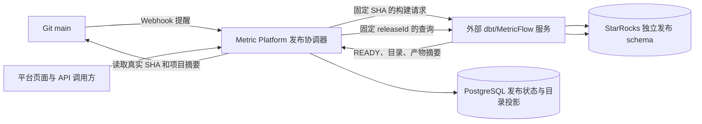

# Metric Platform 的 dbt 全量构建与版本发布设计

日期：2026-09-26。状态：设计稿及实施计划待评审；本文件不授权实施。

后续决策（2026-09-26）：用户已批准退役旧 Ossie、平台自有数据源/语义定义和同步 SQL 查询接口。本文中“保留旧 Ossie 与旧查询接口”的描述仅记录初版设计，不再代表当前实现；现行边界见 [清理实施计划](../plans/2026-09-26-retire-legacy-semantic-stack.md) 和 [运行说明](../../dbt-publication.md)。

## 1. 目标与范围

Metric Platform 消费配置仓库 `main` 中的 dbt 原生 SQL/YAML 定义，在外部 dbt/MetricFlow 服务完成构建和验证后，原子切换平台生效版本。平台提供版本化的只读目录、血缘、发布状态和指标查询。业务定义的事实来源是 Git 中的 dbt 项目；平台数据库只保存发布状态与查询投影。

本轮只设计 `metric-platform/` 的 Git 订阅、发布协调、数据库投影、公开 OpenAPI 和管理控制台。外部服务只定义平台所需的请求、响应与验收条件，不在本轮设计其内部实现。Git 提交者可以是任何具备仓库权限的来源；本轮不涉及 Agent 草稿、交互、确认卡片或专用接口。新链路使用 dbt/MetricFlow 原生产物，不转换为 Ossie；Ossie 协议演进留待后续迭代。

首版固定单配置仓库、`main`、单 dbt 项目和单 StarRocks 部署。保留现有认证模型，不增加租户、多环境晋级或新角色体系。旧 Ossie 同步和旧查询接口继续服务现有调用，同一业务目录只启用一种发布模式。

## 2. 现状与方案选择

- `metric-git-sync` 已能固定远端 Git 快照，但目前只读取 `semantic/model.yaml` 并解析 Ossie；dbt 模式只复用安全的仓库绑定、`main` 与 SHA 校验，不调用 Ossie 解析器。
- `backend/gitsync` 已有 Webhook、启动扫描、轮询和检查点；当前 `GitSyncCoordinator` 是进程内单线程任务，发布新链路需要持久状态、重启恢复及候选版本判旧。
- `GitPublicationService` 在一个 PostgreSQL 事务中导入旧平台实体和检查点；新链路沿用“事务切换生效版本”的原则，不把 MetricFlow 指标压入旧 `MetricEntity` 聚合字段。
- 现有 `POST /api/v1/queries` 是同步 200 契约。新指标查询使用独立命名空间，公开行为同步写入 `api/openapi.yaml`。
- 当前 dbt 服务能通过 `dbt-starrocks` 解析和构建，但 MetricFlow 查询 StarRocks 仍返回 `metricflow_adapter_not_supported`。真实 StarRocks 查询通过验收前，新目录不能标记为可查询。

物理发布采用**每次项目内容变化都在独立 schema 全量构建**。这样每个版本拥有完整的模型 relation 和语义产物，失败不覆盖当前版，旧版本按 schema 回收。代价是只改指标 YAML 也重建全部 table 并运行完整测试；构建耗时与存储必须纳入验收。共享 schema 原地更新会使失败候选影响现有查询，按差异复用旧模型会增加跨版本依赖和回收复杂度，本轮均不采用。

## 3. 平台职责与边界

平台是唯一的发布控制器：决定目标提交、判断旧任务是否过时、检查 READY 产物、保存候选目录并切换 `activeReleaseId`。外部服务只处理平台指定的项目和 SHA，不自行选择最新 `main`，也不修改平台生效指针。平台不运行 dbt 命令、不生成 MetricFlow SQL、不直接修改服务管理的 StarRocks schema。

平台与服务的绑定由部署配置限定为 `projectId → repositoryId + remote + projectSubdir + profileBindingId`。公开 API 不接受任意 Git URL、工作目录、profile 文本或构建 schema。StarRocks 凭据由外部服务持有；平台只保存无凭据的绑定与展示信息。

平台依赖的最小服务 HTTP 契约为：`POST /v1/project-runs` 提交固定 SHA、固定 profile 绑定和幂等键，`GET /v1/project-runs/{runId}` 与 `GET /v1/project-runs/by-key/{idempotencyKey}` 获取状态和验证摘要，`GET /v1/project-runs/{runId}/catalog` 获取版本化目录与依赖，`POST /v1/query-jobs`、`GET /v1/query-jobs/{queryId}` 与 `GET /v1/query-jobs/by-key/{idempotencyKey}` 以 `QUERY / EXPLAIN / PREVIEW` 模式处理固定运行版本的请求，以及 `POST /v1/project-runs/{runId}:cleanup` 清理不再引用的候选 schema。平台客户端只使用结构化请求与结果；超时后先按任务 ID 或幂等键查询状态，再决定是否重试。服务未实现或未通过真实 StarRocks 验收的操作不得在平台标记为可用。

## 4. Git 发现、构建与发布

### 4.1 发现与去重

1. 复用 Webhook、启动扫描和定期轮询。Webhook 只负责唤醒；平台重新读取受信任远端的 `main` SHA，不把事件体的 `after` 当成目标版本。
2. 平台记录 `observedSha` 和 dbt 项目输入文件的内容摘要。首版摘要覆盖项目子目录中的 `dbt_project.yml`、`models/`、`macros/`、`tests/`、`analyses/`、`seeds/`、`snapshots/` 与根层的 `packages.yml`、`package-lock.yml`、`dependencies.yml`、`selectors.yml`；输入目录内的 Markdown 可能包含 dbt docs 块，也必须纳入摘要。只改输入目录外的 README、其他 Markdown、生成目录或项目子目录外文件时只记录 SHA 和 `SKIPPED_UNCHANGED` 观测事件，不启动新构建。摘要按 Git 文件路径、模式和 blob ID 稳定计算；不读取工作树，不把任意未知文件当作可执行定义。项目内容与当前生效版不同才产生候选发布；仅改指标 YAML 等语义定义也属于项目内容变化。首版禁用的 dbt 资源即使被纳入摘要，仍由构建前校验明确拒绝。
   部署时锁定 `dbt_project.yml` 的资源路径配置；若它指向上述范围之外的输入路径，候选发布失败，避免把真实定义变化误判为 README 类无关变更。
3. 候选记录固定目标 SHA、项目摘要、配置版本、工具链版本和幂等键。平台只复用同项目摘要、同配置且结果可验证的在建或已完成构建；不同项目内容的提交必须重新从头构建。若同摘要与同配置的前次候选因定义、构建或测试错误确定性失败，后续仅改 README 等非输入文件的提交只更新观测 SHA，不重新构建；需要项目输入或受控配置发生变化才重新尝试。

### 4.2 全量构建与 READY 门槛

平台向服务提交固定 SHA 的运行请求，服务在新 StarRocks schema 中解析并构建该提交的全部允许模型，运行完整 dbt 测试与语义验证。首版模型物化范围为 table、view、ephemeral；ephemeral 随下游编译，跨发布 incremental 状态、snapshot 和异步物化视图不在本轮范围。无论变化文件是模型 SQL、source YAML 还是指标 YAML，都执行同样的完整构建流程。

服务返回 READY 时必须同时给出固定 SHA、项目摘要、profile/工具链版本、独立 schema、`manifest.json`、`semantic_manifest.json`、`run_results.json` 的摘要、版本化目录与依赖 DTO，以及全部物理 relation 的验证结果。平台校验语义模型与时间骨架引用的 relation 都存在，完整测试通过，且代表性 MetricFlow explain 和有界查询在真实 StarRocks 上通过。仅 parse 成功或只生成 SQL 均不构成 READY。

当前 MetricFlow 尚不支持 StarRocks 查询，因此该能力的真实库验收是上线门槛。外部服务未给出可验证的查询能力时，候选不能发布成可查询的指标版本；平台不退回旧 SQL 编译器生成新指标结果。

### 4.3 发布点、并发与回滚

服务 READY 后，平台先保存完整候选目录和验证结果。切换前重新读取远端 `main`，在 PostgreSQL 短事务中比较已观测目标、项目摘要、发布序号与 expected activeReleaseId，并原子更新 `activeReleaseId`。事务提交成功才叫**发布成功**。Git push 只触发流程；构建完成、READY 或目录导入均不能提前对外展示候选内容。

若 A 构建期间出现项目内容不同的 B，A 标记 `SUPERSEDED`，B 按最新提交重新全量构建；A 即使成功也不能覆盖 B。若 B 只改项目外文件且项目摘要与 A 相同，A 的构建结果可以用于 B 的发布记录；记录 `targetCommitSha=B` 与 `buildSourceSha=A`。构建失败保留旧版本；回滚通过 Git revert 产生新提交并走相同全量构建与发布流程。

“只发布最新提交”以切换前再次读取到的远端 `main` 为准。Git 更新与平台数据库事务没有跨系统原子锁：若 push 恰好发生在最后一次读取之后，旧候选可能短暂生效；Webhook/轮询随后收敛。已观测到项目内容更新时，旧候选必须被拒绝。绝对消除该窗口需要 Git 分支更新与平台指针共用事务或锁，本轮不引入。

### 4.4 状态、失败与清理

候选状态为 `PREPARING → BUILDING → VALIDATING → READY → PUBLISHED`，终态还包括 `FAILED` 与 `SUPERSEDED`；`SKIPPED_UNCHANGED` 是观测事件，不创建 release。平台保存服务任务 ID 和幂等键，重启后核实任务与产物；结果未知时不盲目重放可能写库的操作。只有网络、服务暂不可用等瞬时故障限次退避重试。定义、构建、测试、目录映射错误等待项目内容修复后的新提交。

每个成功 release 绑定独立 schema。查询在入口固定 releaseId，平台持久记录查询任务与服务任务 ID；重启后仍能识别在途请求。清理任务保留当前、上一成功版和非终态查询引用的版本；其余版本确认无引用后，通过外部服务按整个 schema 清理。同摘要不同 SHA 复用同一个物理 run/schema 时，必须按 runId 汇总所有 release 和在途查询引用，不能因清理过时的 A 而删除已发布的 B。查询受理与清理认领必须在同一 release 行锁下互斥：先持久占用版本，再提交服务任务；清理先原子标记 `CLEANING` 并拒绝该版新查询，再调用服务删除；失败恢复为待清理，成功标记 `CLEANED`。失败或过时的候选 schema 也由后台请求服务清理。清理不得发生在查询请求路径上。table 数据是本次构建时的快照，view 仍可能读取变化的上游 source；本设计不提供历史数据快照或定时数据刷新。

## 5. 平台持久模型

在现有 PostgreSQL 中使用新增 Flyway 迁移建立独立于旧 Ossie 实体的版本模型：

| 表 | 最小内容 |
| --- | --- |
| `semantic_project` | 项目与仓库/profile 绑定、observedSha、observedProjectDigest、lastObservationStatus、lastObservedAt、activeReleaseId、发布序号 |
| `semantic_release` | releaseId、targetCommitSha、buildSourceSha、项目摘要、服务任务 ID、配置/工具链版本、schema、状态、验证摘要、清理状态、错误与时间 |
| `semantic_resource` | releaseId、稳定 resourceId、原生 dbt/MetricFlow 标识、类型、名称、描述、可检索字段、原生定义 JSON、来源文件和查询能力 |
| `semantic_dependency` | releaseId、上下游 resourceId 与依赖类型 |
| `semantic_query` | queryId、projectId、releaseId、服务任务 ID、状态、提交和完成时间、结果定位与脱敏错误；非终态记录保护对应 schema |

定义原文仍由 Git 维护；投影不可就地编辑。目录导入和生效指针切换在事务边界内保持可见性一致，候选目录在发布前不进入默认读取路径。稳定 resourceId 不包含 releaseId；同一对象的版本内容通过 releaseId 区分，重命名视为旧对象删除与新对象创建。旧 `git_sync_state` 与旧业务实体只供旧模式使用，不把 dbt 模型映射成旧聚合枚举。

## 6. 公开 API 与页面

新增 `/api/v1/semantic-projects` 及其 `{projectId}` 子路径，沿用平台现有 Bearer 认证。`api/openapi.yaml` 必须与路由、请求、202 异步任务、结果类型和错误保持一致：

| 路径 | 作用 |
| --- | --- |
| `GET /api/v1/semantic-projects` | 列出已配置的 dbt 项目及当前生效版本，供控制台选择 |
| `GET /catalog`、`GET /resources/{resourceId}`、`GET /resources/{resourceId}/lineage` | 按 releaseId 读取只读目录、定义来源和有界血缘 |
| `GET /releases`、`GET /releases/{releaseId}` | 查看观测 SHA、生效版本、阶段、耗时与脱敏诊断 |
| `POST /queries:explain`、`POST /queries`、`GET /queries/{queryId}` | 固定 releaseId 的 MetricFlow 解释与异步查询；提交操作返回 202 |
| `POST /datasets/{resourceId}:preview` | 对已发布 relation 提交有界异步预览并返回 202，不接受任意 SQL |

目录响应返回 releaseId；后续查询显式携带该版本。已清理版本的目录与新查询返回 410，不属于项目的版本返回 404，均不自动改用当前版本；发布历史元数据仍可读取并显示清理状态。查询结果包含 releaseId、targetCommitSha、列类型、行数据、截断标记和耗时；Decimal/大整数保留精度。维度组合与过滤合法性由 MetricFlow 验证，平台只接收类型化参数，不拼接用户 SQL。

控制台沿用现有数据集、指标、维度与查询工作台的布局，新增发布状态页，区分 Git 最新观测 SHA 与当前生效 release。dbt 目录展示来源文件、口径、血缘、构建时间和能力；定义页面只读，后端同样拒绝对 Git 托管对象的写入。旧目录页面和同步查询接口保持既有行为，不静默改变 `/api/v1/queries` 的 200 响应。

## 7. 验收与实施边界

上线前先验证 MetricFlow → StarRocks 的查询能力：简单聚合、精确去重、日期/地区分组、事实到维表关联、比率/派生指标在真实库的结果与基准 SQL 一致。随后验证单提交全量构建、独立 schema、失败隔离和语义产物 relation 指向。平台代码可以在 DBT 模式默认关闭的条件下开发和测试；只有这两项真实服务验收通过，才允许启用主发布链路并宣称其可用。

平台验收至少覆盖：首次和后续项目内容变化都构建全部模型；只改指标 YAML 也重建 table；README 变更只记录 SHA；A/B 不同内容并发只让已观测最新提交发布；同内容不同 SHA 可复用构建；构建/测试失败、服务重启和限次瞬时重试不覆盖旧版；发布切换中的在途查询保持版本；旧 schema 只在无引用后回收；目录与 `api/openapi.yaml` 一致。

本轮不设计或实现 Agent 交互、草稿校验、确认推送、外部 dbt/MetricFlow 服务内部、Ossie 转换、多环境晋级、定时刷新和旧资产迁移。后续实施计划只拆分 `metric-platform/` 内的代码、数据库、OpenAPI 与页面工作；外部服务能力作为明确前置依赖单独验收。

## 8. 依据

- `metric-platform/docs/git-sync.md`：现有 Webhook、轮询、Ossie 同步与检查点行为。
- `metric-platform/backend/src/main/java/com/metricplatform/gitsync/`：当前 Git 消费、状态和事务发布实现。
- `metric-platform/backend/src/main/java/com/metricplatform/query/QueryController.java`：现有同步查询 API。
- `metric-platform/api/openapi.yaml`：公开契约。
- `dbt-metricflow-service/README.md`：当前 dbt 命令能力及 MetricFlow 的 StarRocks 限制。
- [dbt manifest](https://docs.getdbt.com/reference/artifacts/manifest-json)、[dbt semantic manifest](https://docs.getdbt.com/reference/artifacts/sl-manifest)、[StarRocks dbt 集成](https://docs.starrocks.io/docs/integrations/dbt/)。
