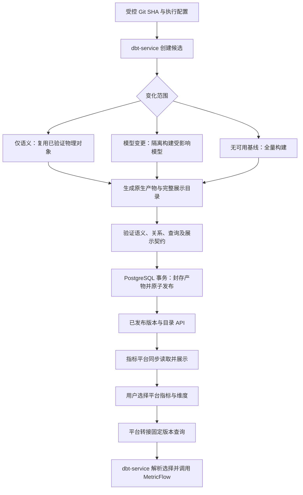

# dbt-service 统一发布与指标平台代理读取设计

日期：2026-09-30

状态：设计已获用户确认，进入实施计划阶段；本文不表示代码已实现。

范围：dbt-service 负责物理构建、语义验证、完整展示产物生成与唯一发布；指标平台负责已发布目录的代理读取、展示、身份认证和查询转接。

## 1. 用户要求与最终边界

用户明确要求：指标平台只负责同步 dbt-service 的发布结果和产物信息，不能出现 dbt-service 发布成功之后，指标平台再因导入或模型转换失败而拒绝该版本。

据此，本设计取消之前的“两阶段业务发布”：不再由 dbt-service 报告 READY 后，指标平台转换产物、导入目录并自行决定 PUBLISHED。平台展示所需的完整指标、维度、数据集、物理关系和查询映射，全部在 dbt-service 发布成功之前生成并验证。

唯一发布事实及活动版本指针属于 dbt-service。指标平台没有独立的目录导入状态机、发布事务或活动版本决策。平台上的资源是 dbt-service 已发布展示产物的只读视图。

用户在比较镜像表与代理读取后，明确选择代理读取。指标平台通过服务 API 读取已经生成、验证并发布的类型化目录，不维护指标、维度、数据集、表或视图的本地镜像表，不增加资源同步落库任务。既有目录表仅按迁移章节保留兼容记录，不作为新流程的读取源。

代理读取不是每次重新解析 YAML 或 manifest。dbt-service 在发布前完成语义理解与目录生成，读取接口直接检索该版本的展示产物；平台只进行认证、HTTP 转接和页面渲染。首版不新增目录缓存，后续确有性能需求时才按固定版本引入可丢弃缓存。

“没有独立导入失败”不等于网络永远可用。网络或服务暂时不可达时，是读取不可用或尚未观察到新版本；不能将其记为发布失败、导入失败，也不能让平台退回或否决 dbt-service 的已发布状态。

## 2. 当前实现与本次调整

| 部分 | 当前工作区实现 | 目标职责 |
| --- | --- | --- |
| 原生产物存储 | dbt-service PostgreSQL 保存产物文件、catalog_json 和验证结果 | 沿用并增加完整展示产物、物理绑定和发布记录 |
| 运行完成 | 运行服务成功任务对外映射为 READY | 执行成功与项目发布区分；只有发布事务提交才报告 PUBLISHED |
| 活动指针 | 指标平台持有 activeReleaseId | 移交 dbt-service，成为唯一权威指针 |
| 原子发布 | 平台 PublicationStore 导入目录并切换版本 | 移到 dbt-service PostgreSQL 的本地事务 |
| 目录映射 | 服务提取原生目录，平台解释原生 JSON | 服务在发布前产出稳定的类型化目录和详情 |
| 平台查询 | 平台校验本地版本、建立任务并转接引擎 | 平台转接平台资源 ID；服务验证版本、转换参数并受理查询 |
| Git 观察和构建调度 | 平台 ReleaseWorkflow 控制候选 | dbt-service 控制；平台仅展示发布结果和运行进度 |

现有 metric-platform/AGENTS.md 中“平台持有发布指针和版本目录”与本次用户新要求冲突，以用户明确要求为准。实施时同步更新该规则、README、运行说明和 OpenAPI；本次只修订设计文档。

旧方案中的平台 CatalogProjector、发布后导入、CATALOG_IMPORT_FAILED、平台新投影列及平台原子切换流程均不再属于目标设计。旧代码的存在仅用于兼容迁移，不能延续成第二套发布权威。

## 3. 总体流程



dbt 解析项目并按需构建物理模型。MetricFlow 校验语义、生成查询计划和 SQL；它本身不承担项目发布事务。dbt-service 编排二者并负责完整产物生成和唯一发布。指标平台负责用户界面、身份认证、传输层适配和查询转接，不自行解析 YAML 或 manifest 来形成业务目录。

Data Agent V2 继续通过指标平台公开 HTTP API 访问，不跨仓库导入代码或直接访问服务数据库。

## 4. 构建模式与物理对象复用

### 4.1 三种模式共用同一个发布出口

| buildMode | 条件 | 行为 |
| --- | --- | --- |
| SEMANTIC_ONLY | 基线可复用，物理执行相关输入未变化 | 解析新定义、复用物理对象、校验语义与查询，不重建表和视图 |
| SELECTIVE_BUILD | 能准确判定物理变化和影响范围 | 构建新增、变化模型及受影响下游，复用其他模型 |
| FULL_BUILD | 首次发布、基线失效、环境不兼容或变化范围不确定 | 隔离全量构建并验证 |

三种模式都生成完整的新版本展示目录和新的运行上下文。指标平台不需要按模式拼装资源或补齐历史信息。

仅指标、维度、实体或说明发生变化时，也必须验证字段引用、关系、查询能力和所需测试。不建表不代表跳过发布验证。不同 SHA 仍可产生独立候选；仅 README 变化可走 SEMANTIC_ONLY。

### 4.2 变化判定

基线只能来自已发布版本。运行服务固定基线 run，使用 dbt 状态比较和依赖图确定影响范围，保存计划和选择原因。SQL、宏与依赖、模型配置、source 绑定、vars 及影响编译的环境配置都属于输入；不能仅按文件扩展名判定语义或物理变化。

逻辑比较状态与物理命名分别管理，避免每次 run 前缀变化让所有模型都被误判为修改。用户真实修改的 schema、alias 和模型配置仍需纳入比较，无法可靠区分时回退 FULL_BUILD。

源数据变化与定义变化分开处理。Git 发布不替代数据刷新调度；目录记录复用对象来源和验证时间，不宣称本次重新计算过它。配置的数据新鲜度条件不满足时，应重建相关模型或阻止发布。

首版不默认启用行级 incremental 写入。后续启用时，必须先为候选提供隔离的基线表并验证 adapter 策略，不能修改活动版本共用对象。

### 4.3 完整物理绑定

每个候选保存 relationBindings，记录模型原生 ID、实际 relation、对象创建 run、绑定方式 BUILT/REUSED/EXTERNAL 和可复用定义摘要。

- BUILT：本候选新建，使用本 run 的物理命名前缀。
- REUSED：复用已验证对象，保留实际旧前缀，只读使用。
- EXTERNAL：受控外部 source，只读引用，不代表历史数据快照。

dbt ref、最终 manifest、semantic manifest、视图依赖和 MetricFlow 必须指向同一绑定集合。defer 可帮助解析未构建上游，但不能独自代替完整物理绑定；在最终语义解析前应用受控映射，再由工具链生成和验证产物。

复用视图的实际依赖不能被遗漏。上游需要切换新对象时，受影响的下游视图也纳入构建。来源直接记录实际创建对象的 run，避免多次发布形成无限的间接复用链。

## 5. dbt-service 持久化完整发布包

### 5.1 存储边界

| 存储 | 内容 |
| --- | --- |
| runtime_artifact_set | 产物集身份、源码 SHA、配置与工具链、摘要、原生目录、展示目录元数据、验证证明 |
| runtime_artifact_file | manifest、semantic manifest、catalog、各执行步骤结果及类型化展示产物的文件内容与摘要 |
| runtime_job | 执行任务、尝试、幂等键和固定 output_set_id |
| 新的 runtime_release | 唯一发布身份、项目内序号、目标 SHA、run、artifactSetId、状态、发布摘要及时间 |
| runtime_project 增量字段 | 最新候选序号、已观测输入以及 active_published_release_id |
| StarRocks | 真正的业务表、视图和数据 |

runtime_project.current_output_set_id 当前表示最近成功的默认执行输出，通用 dbt 命令也可能更新它，不能直接用作公开发布指针。新增专用 active_published_release_id；表和字段通过 dbt-service 自有迁移建立，不跨库操作。

指标平台自有数据库保留身份、必要的访问审计和既有兼容记录。新目录展示和查询受理不依赖其 semantic_resource 或 semantic_release 的同步写入。首版不新增本地资源镜像表或必须成功的后台导入任务。

### 5.2 发布包内容

- 本次候选生成的 manifest.json 和 semantic_manifest.json。
- 按最终物理绑定重新采集或验证后组装的 catalog.json。
- 实际执行步骤的结果文件、选择集合与状态；构建、测试、文档步骤不得覆盖前一步的唯一证明。
- relationBindings、buildMode、基线引用和完整验证报告。
- published_catalog.json：可直接供平台展示的完整、类型化资源、详情和关系快照，具有独立 catalogSchemaVersion。
- 服务内部查询绑定：资源身份到引擎名称、模型和运行目标的映射。

published_catalog.json 是服务新增的发布产物，不是 dbt 原生 catalog.json。它必须加入文件采集允许列表、摘要计算和封存验证范围；文件保存与可选数据库查询索引来自同一内容。若规模要求分页，可在封存前建立服务端索引；索引准备失败属于发布前失败，不能在发布后等待指标平台建索引。

SEMANTIC_ONLY 的物理构建步骤明确记为 NOT_REQUIRED；不得复制旧 run_results 冒充本次执行。实际测试仍有本次执行证明；没有可执行测试时记录明确空集合及原因。

完整快照包含未修改资源，但不预计算所有指标和维度组合。动态 query-options 仍在查询时由固定运行上下文计算。

### 5.3 发布前的全部门槛

服务在报告 PUBLISHED 前完成：

1. 产物文件完整性、schema 版本、长度、摘要和所属 run 校验。
2. 当前模型集合被成功构建与已验证复用完整覆盖，source 单独验证。
3. 必需测试、语义配置校验、物理关系验证及代表性查询通过。
4. manifest 与 semantic manifest 经工具链规范化后的语义集合、引用、维度、时间配置和 relation 一致。
5. 展示产物通过类型化 schema、唯一 ID、关系端点、归属及查询绑定验证。
6. 候选仍是最新可发布输入，worker 租约有效，执行配置与目标 SHA 匹配。

展示转换失败、数据库约束失败、关键字段无法映射，都发生在服务发布之前；候选失败，旧版本继续生效。指标平台不重复执行这些业务验证。

产物协议采用明确、受支持的稳定版本。破坏性升级必须先部署兼容消费者或同时生成兼容表示，再允许生产者发布新格式；不是发布后等待消费者尝试导入。协议契约测试覆盖生产者输出和平台读取，平台仍执行必要的 HTTP/JSON 边界检查，但协议违约是服务故障，不是另一个发布状态。

## 6. 服务生成的平台目录模型

### 6.1 资源和身份

保留 METRIC、DIMENSION、SEMANTIC_MODEL、TABLE、VIEW 类型；界面将 SEMANTIC_MODEL 展示为“数据集（语义模型）”。不再创建同一语义模型的重复 DATASET 对象。

统一定位为 projectId、releaseId、resourceId。releaseId 由 dbt-service 管理，一个发布固定关联一个 run 和一个 artifactSetId。原生 ID 可直接作为资源 ID；维度包含所属模型身份。名称相同不自动合并，改名按旧身份消失和新身份新增处理。

同一模型可对应多个数据集，指标可依赖多个数据集。物理前缀变化不改变逻辑资源身份。

### 6.2 展示字段

公共字段包括 resourceId、nativeId、kind、name、displayName、description、sourcePath、capabilities。displayName 优先取上游 label，否则回退机器名称。

| 类型 | 类型化 attributes |
| --- | --- |
| 指标 | metricType、definitionSummary、inputMetricIds、datasetIds、filters、timeConfig |
| 维度 | datasetId、dimensionType、expression、timeGranularity |
| 数据集 | modelResourceId、dimensionIds、entities、measures、defaultTimeDimension |
| 表、视图 | origin、relation、columns |

definitionSummary 通过受支持语义字段的确定性规则生成，不使用 AI 推断口径，也不构造平台自有执行语言。无法准确解释关键类型时阻止服务发布；非关键扩展字段保留原生详情。

服务使用 kind 判别的类型联合校验完整详情。平台页面只渲染这些字段，列表搜索、分页、类型筛选由服务针对已发布目录执行，不在平台重新扫描 manifest。

### 6.3 关系和查询能力

关系保留模型依赖、数据集与维度归属，补齐物理模型到数据集、数据集到指标、输入指标到派生指标。只从已知格式的原生引用生成，不猜测任意 SQL 血缘；循环依赖、悬空的必需引用和重复资源阻止发布。

定义上的归属与查询合法组合分开。数据集包含某维度不等于任意指标都可按它查询。MetricFlow 判断共同维度、join 路径、metric_time、粒度和筛选能力。

物理预览要求有效 relation 和 preview 能力；不能因语义模型在界面叫数据集就自动赋予物理预览能力。维度值查询需要指标上下文。

## 7. 唯一发布状态机与原子切换

执行状态与发布状态分别记录。通用执行任务的 SUCCEEDED 或兼容接口的 READY 只说明执行完成，不作为指标平台的新版本发现入口。

新发布候选采用 PREPARING、BUILDING、VALIDATING，终态为 PUBLISHED、FAILED、SUPERSEDED。仅语义候选可以跳过物理 BUILDING。没有“等待指标平台导入”的状态。

```text
事务外：固定输入 → 构建或复用 → 生成完整产物 → 验证全部发布门槛

BEGIN（dbt-service PostgreSQL）
  锁定项目、候选和输出产物集
  验证最新候选、预期活动版本及 worker 租约
  校验并封存输出产物集及完整展示目录
  固定 releaseId → runId → artifactSetId
  将候选标记为 PUBLISHED
  将 active_published_release_id 从 A 切换为 B
  记录发布时间及发布序号
COMMIT
```

物理 SQL 不在这个数据库事务内。事务中任一步失败，旧指针 A 保持不变；B 的暂存产物不对外作为已发布目录暴露。发布成功的唯一判据是该事务提交，不依赖平台回调或同步确认，也不要求平台在线。

提交结果未知时重新读取发布记录和活动指针。B 已 PUBLISHED 就认定已提交，即使随后被 C 替代；不能将未知提交误记为失败。过期 worker、重复回调和较晚完成的旧候选不能覆盖更新版本。

run 的输出产物封存可复用现有 JobStore.finish 的事务设施，但现有实现还没有上述唯一项目发布事务，实施时必须补齐，不能只把 READY 文案改成 PUBLISHED。

## 8. 新旧资源与物理隔离

A、B 各有完整的展示、定义和查询绑定快照。B 修改资源不会更新 A 的记录；B 删除资源仅表示新快照不包含它。相同逻辑 ID 可以存在于不同 release。

发布成功时，服务活动指针一次切换整套指标、维度、数据集、关系和查询上下文；不逐条替换平台对象。明确的空项目可以发布完整空目录，产物损坏或目录缺失不能冒充空发布。

构建 B 只能写 B 的新建对象，复用对象和外部 source 为只读。最终 relation 检查之外，还要通过受控构建模板、数据库权限或等价运行约束阻止宏和脚本写入 A。否则仅靠目录原子切换不能保证旧查询不受影响。

旧产物与物理对象保留供在途查询和新版本复用；不自动删表。人工清理必须检查完整物理绑定和查询引用，不能仅按来源 release 不再活动判断。

本次不增加人工回滚入口。保留旧快照不自动意味着可以无条件切回其运行环境。共享 source 的外部更新不属于语义快照保证，物理隔离也不承诺构建负载对查询性能零影响。

## 9. 指标平台代理读取已发布目录

### 9.1 读取路径

1. 平台请求服务的项目已发布版本接口，得到 active releaseId、runId、artifactSetId、发布序号和目录协议版本。
2. 按这个 releaseId 请求完整目录的分页、类型化详情、关系或源码。
3. 平台保持资源身份、版本字段和字段含义，做必要的 HTTP 包装后交给页面。
4. 页面固定该 releaseId 读取相关信息；不在不同请求中隐式切换为其他版本。

首版直接读取服务的已发布展示产物。不再调用原生目录接口完成第二次业务转换，不以写入本地资源表为返回成功的前提。源码追溯也由服务基于封存的固定版本提供，平台不额外读取 Git main。

| 用户操作 | 指标平台行为 | dbt-service 行为 |
| --- | --- | --- |
| 浏览、搜索和分页查询指标、维度、数据集、表或视图 | 转发版本及筛选参数，渲染返回结果 | 查询已发布目录 |
| 查看字段、详情和资源关系 | 转发资源 ID 和 releaseId | 返回预生成的结构化属性与关系 |
| 选择指标后的维度、粒度和筛选选项 | 转发平台资源 ID | 结合固定版本调用 MetricFlow 获取合法选项 |
| 指标计算、维度值查询和物理预览 | 转发请求并展示任务结果 | 校验版本、转换标识、受理并执行查询 |

### 9.2 缓存与同步故障

本次不实现持久化镜像或目录缓存。以下是未来引入缓存时的边界：键必须包含 projectId、releaseId、artifactSetId 和目录协议版本；仅缓存完整验证过的 HTTP 响应，失败不得写入半份资源或推进本地权威指针。

缓存未命中或损坏时直接读取服务，不触发导入。当前活动版本通过服务确认，不能依据陈旧缓存承诺新查询仍可用。用户浏览器已展示旧页面时可以保留内容并标注版本，服务不可达时明确提示读取异常。

服务发布成功与平台观察到它之间可能有网络延迟。平台只报告“已发布版本 X”或“最近读取版本 X、当前读取失败”，不新增“导入失败”或“本平台发布失败”。如果服务及缓存都不可用，返回读取不可用；不能把读取故障包装成发布回滚。

轮询用于重新发现最新已发布指针；通知可以以后作为加速，不作为正确性依赖。乱序通知或重复读取不能使页面静默混合不同版本。首版不引入必须成功投递的消息队列或跨服务提交协议。

## 10. 可视化查询与服务端转接

用户在页面选择平台指标、维度、时间粒度和筛选条件，不需要 YAML、SQL、原生指标名或 MetricFlow 路径。

```text
页面提交 releaseId + metricResourceIds
  → 指标平台转接 query-options 请求
  → dbt-service 映射引擎名称并调用 MetricFlow
  → 返回平台选项 ID、名称、粒度及筛选能力
页面提交平台资源 ID 和选项 ID
  → 指标平台转接查询
  → dbt-service 验证、转换、预留任务并执行
```

optionId 由服务根据固定 release、规范化指标集合和原生选项身份确定性产生。不同 join 路径可以对应不同选项；metric_time 等合成维度不伪造目录 resourceId。服务重新验证提交的选项、粒度和操作符，不接受前端提供任意原生路径。

查询受理与发布指针切换在 dbt-service 同一项目锁边界内串行化。动态选项计算在事务外，预留事务内再次验证活动版本并保存固定 run、转换后请求和幂等键。发布先完成则拒绝旧版新查询；查询先预留则按旧版执行，即使尚未发送到引擎。

指标平台不再以本地查询记录成功落库作为受理条件。服务返回稳定 queryId，平台转发状态与结果；请求超时后用同一幂等键查询或重试，不创建不同任务。必要访问审计不能变成第二道发布或查询执行状态机。身份认证仍由平台实施，服务访问使用受控绑定，不能把客户端伪造的身份直接视为可信。

B 发布后，旧页面对 A 的新查询返回 410 并提示刷新。刷新后可尝试保留仍存在的指标 ID，但必须重新读取 B 的查询选项，删除或失效选项明确提示。A 已受理查询继续返回带 A releaseId 的结果。

## 11. API 契约

### 11.1 dbt-service 新的发布读取接口

以下为拟定的新版本接口，避免把现有任务 READY 接口冒充已发布资源：

| 接口 | 含义 |
| --- | --- |
| GET /v2/projects/{projectId}/publication | 返回服务唯一活动发布描述；未首次发布返回明确的无活动版本表示 |
| GET /v2/projects/{projectId}/releases | 返回发布记录、失败候选与执行进度，只有 PUBLISHED 可作为已发布版本 |
| GET /v2/projects/{projectId}/releases/{releaseId}/catalog | 按 q、kind、page、size 读取已发布完整快照的分页 |
| GET /v2/projects/{projectId}/releases/{releaseId}/resources/{resourceId} | 类型化详情，另提供固定版本原生详情、关系和源码子资源 |
| POST /v2/projects/{projectId}/query-options | 接收 releaseId 和 metricResourceIds，返回平台选项 |
| POST /v2/projects/{projectId}/queries | 接收 releaseId、资源和选项 ID、查询模式与幂等键 |
| GET /v2/projects/{projectId}/queries/{queryId} | 返回固定版本的状态与结果 |

发布描述包含 projectId、releaseId、runId、artifactSetId、publicationSequence、publishedAt、sourceSha、buildMode、catalogSchemaVersion 和摘要。按版本返回的响应必须携带 releaseId；资源和查询必须校验项目归属。

SEMANTIC_ONLY、SELECTIVE_BUILD、FULL_BUILD 使用完全一致的发布读取 API。目录过滤后分页，排序使用 resourceId 作为稳定次序。失败候选不能通过目录读取 API 被当作当前资源。

### 11.2 指标平台接口

保留平台现有认证和对外命名空间；新类型化详情和 v2 平台资源查询接口转接上面的服务契约。旧 v1 接口若需兼容，服务在发布前准备相应兼容字段或由平台做固定的传输字段重命名，不能在请求时再次解释 dbt 原生定义。

平台上的“刷新”只重新读取服务发布结果；本次不在平台保留 Git 观察、生成候选或批准发布能力。项目发布由 dbt-service 自己的受控入口或调度启动。目录、查询的新旧协议和错误行为同步更新 api/openapi.yaml。

### 11.3 版本访问

保持当前用户体验约束：非活动历史版本可读发布记录，目录和新查询返回 410，已受理查询仍可完成。该判定统一由 dbt-service 执行；平台不使用过时的本地记录自行判定版本有效性。

本次不新增租户、角色、资源授权模型。服务调用认证与平台当前全局身份边界保持一致。

## 12. 失败与恢复规则

| 场景 | 唯一结果 |
| --- | --- |
| dbt 构建、测试或 MetricFlow 验证失败 | 服务候选 FAILED，活动版本不变 |
| 展示产物映射、协议校验或索引准备失败 | 服务候选 FAILED，不能报告发布成功 |
| 产物暂存、封存、发布事务失败 | 不切活动指针；无可见的半份发布 |
| 发布提交成功但响应丢失 | 查询权威发布记录确认，不重复切换或误标失败 |
| 服务已发布，平台离线 | 发布仍成功；平台恢复后读取权威指针 |
| 平台本地数据库写入失败 | 新目录读取不依赖资源导入，不产生导入失败；认证等独立故障按其本身报告 |
| 平台缓存或网络失败 | 缓存旁路或读取不可用，不能改变发布状态 |
| 新格式不兼容 | 在生产者启用前通过版本协商和兼容部署解决；协议违约按服务故障处理 |
| B 成功后 C 发布，B 的读取晚返回 | 页面按固定请求上下文处理，不能混合 B/C 资源或倒退最新展示 |
| 完全空项目 | 服务验证完整空发布后一次切换；平台展示无资源 |

不引入跨服务分布式事务，不等待指标平台的确认消息后才修改已发布状态。把所有可能的业务转换失败提前到 dbt-service，才消除“服务发布成功、平台业务导入失败”的第二道关卡。

## 13. 迁移顺序与变更归属

1. dbt-service 新增发布记录、权威指针、展示产物和版本化读取 API，完成生产者契约测试。
2. 完成语义发布、选择性构建、绑定与分步骤证明；原有调用方仍默认旧全构建协议。
3. 平台增加只读服务适配和新页面接口，在切换之前验证服务产物可直接展示和查询。
4. 在受控迁移窗口暂停旧平台发布写入，验证并接管当前活动版本，或在服务完成首次新发布。对已存在的公开 releaseId/queryId 保留明确兼容映射，不静默更换历史身份。
5. 切换平台读取入口到服务权威发布 API，停用平台 Git 发布调度、目录导入和活动指针写入。切换期间只有一个发布写入者。
6. 旧平台目录与发布表先保留用于兼容和审计，不修改已应用迁移，也不自动删除旧数据；不以恢复旧平台调度作为常规应用回退手段。
7. 更新两个仓库的职责文档和契约。回退界面或适配层时仍保留服务作为唯一发布权威，避免双写。

原有“平台发布任务预留”“平台资源投影入库”的实现计划失效，后续计划必须按本设计重新编排。指标平台的现有业务发布逻辑需要退出运行路径，而不是换个名字继续执行。

只修改归属仓库；根仓库不放产品代码。Data Agent 仍通过平台 API 集成。遵守现有不创建额外 worktree、独立构建及迁移约束。

## 14. 验收矩阵

| 验收 | 预期 |
| --- | --- |
| 服务展示转换故意抛错 | 服务发布失败，旧版本继续可读可查询 |
| 服务报告 PUBLISHED | 完整展示目录已持久化且可按固定版本读取，没有等待平台导入的步骤 |
| 平台目录数据库写入被禁用 | 新目录读取和查询转接仍正常，证明不存在必要导入 |
| 平台停机期间服务完成发布 | 平台恢复后直接发现完整新版本 |
| 发布事务各阶段故障注入 | 无资源半更新、无状态和指针分裂 |
| 提交响应丢失与重复 worker 回调 | 依据数据库状态恢复，已发布版本不被误标失败 |
| 较旧候选晚完成 | 不覆盖最新候选对应的发布顺序 |
| 各模式的发布产物 | 相同类型化契约、完整资源快照、准确执行证明 |
| 同名维度、多数据集指标、派生依赖 | 身份、归属和展示正确，查询映射由服务验证 |
| 非法选项、跨版本选项、任意原生路径 | 服务拒绝，前端无法绕过合法组合 |
| A 查询先受理再发布 B | 查询继续固定 A，A 的新查询随后被拒绝 |
| 活动表写入隔离 | B 失败不改变 A 的受管理物理对象 |
| 模型复用和下游视图 | 最终查询引用准确；不会指向缺失的新前缀对象 |
| 产物被截断、摘要错或展示文件未入库 | 不能成功发布 |
| 仅语义变更无构建结果 | 明确 NOT_REQUIRED，测试与查询证明仍完备 |
| 目录或血缘读取失败 | 明确读取错误，不能展示为无资源或无依赖 |
| 旧 API 和身份迁移 | 兼容调用方不因活动指针迁移而静默改义 |

验证覆盖运行服务单元与 PostgreSQL 事务测试、平台只读转接契约、前端版本行为和真实 dbt/MetricFlow 查询验收。新增测试聚焦所改边界，不弱化现有测试；移除旧业务行为的测试需由明确的新职责断言替代，并按用户规则管理测试变更。

## 15. 评审结论与依据

本次修订的关键决定：发布只有一次，发生在 dbt-service。平台需要的资源信息也是发布产物，必须与原生产物一起生成、验证和固化。指标平台消费的是已完成的资源目录，拥有的是只读视图和查询门面，不拥有第二次导入或发布决定。

当前实现依据：dbt-service storage/artifacts.py、storage/jobs.py、runtime.py、platform_catalog.py；指标平台 ReleaseWorkflow、PublicationStore、CatalogReadStore、DbtArtifactPresenter、QueryService 和 api/openapi.yaml。当前源码仍有旧职责，本设计需要后续实施才能生效。

官方能力依据：[MetricFlow 命令](https://docs.getdbt.com/docs/build/metricflow-commands)、[Semantic Layer 部署](https://docs.getdbt.com/docs/use-dbt-semantic-layer/deploy-sl)、[dbt defer](https://docs.getdbt.com/reference/node-selection/defer)、[增量模型](https://docs.getdbt.com/docs/build/incremental-models)。托管平台部署能力不等于开源 MetricFlow 自带原子发布。
