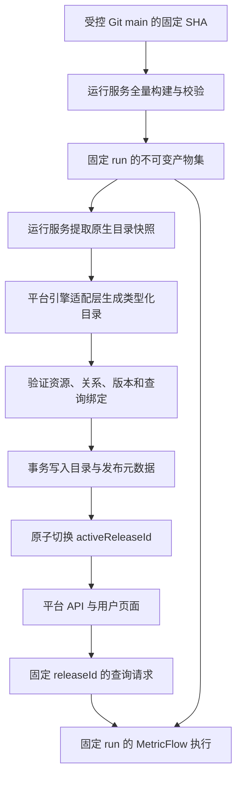

# 基于发布产物的平台语义目录设计

日期：2026-09-30  
状态：完整设计草案，待评审；本文不代表实现已完成。  
范围：Metric Platform 的产物消费、平台目录生成、发布一致性、用户展示与查询衔接。

## 1. 目标与已确认的方向

dbt 项目维护指标、维度与语义模型的定义；dbt/MetricFlow 负责构建、校验和查询执行。指标平台消费成功构建的固定版本产物，生成自己的只读、版本化目录。用户与 Data Agent 通过平台 API 获取目录，不在每次页面访问时读取完整 manifest，也不自行解析原始 YAML。

本设计沿用用户已认可的方向，并采用以下明确假设：

- 平台不提供计算定义的独立编辑与双向同步；定义修改仍经过 Git 和发布流程。
- 用户界面的“数据集”指语义模型，物理表、视图作为另一类资源。一个数据集关联一个底层 dbt model，一个 model 可以被多个语义模型引用。
- 延续当前活动版本访问规则：历史版本可查看发布记录，但其目录和新查询返回 410；已受理查询继续绑定原版本执行。
- 不新增收藏、业务分类、审批、租户隔离、历史目录浏览或物理表自动清理。这些能力不属于本次目录流程。

成功标准：普通目录与详情请求只读取平台目录；用户看到的平台对象有明确含义和可追溯来源；目录与查询固定同一版本；新版本导入失败不会改变当前可见目录；平台不重写 MetricFlow 的计算语义。

## 2. 当前实现与需要补齐的部分

以下结论来自当前工作区源码，而非历史设计文档：

| 环节 | 当前实现 | 本次设计的增量 |
| --- | --- | --- |
| 产物解析 | 运行服务 `platform_catalog.py` 读取 manifest、semantic manifest、catalog | 明确版本化输入契约、资源归属和产物一致性 |
| 目录来源 | 指标与语义模型来自 manifest；维度从语义模型展开；物理列来自 catalog | 保持来源，生成平台类型化投影 |
| 目录传输 | `GET /v1/project-runs/{runId}/catalog` 返回目录 DTO | 补齐 run、产物摘要和协议版本绑定 |
| 平台持久化 | `semantic_resource` 保存公共字段及原生 `definition_json`；依赖另存 | 保存发布时生成的平台属性，不再由页面请求解释原生定义 |
| 原子发布 | `PublicationStore` 同一事务写目录并切换活动指针 | 把类型化投影纳入同一事务和完整性检查 |
| 详情展示 | `DbtArtifactPresenter` 请求时从原生 JSON 提取字段；前端通用 JSON 展示较多 | 增加平台类型化详情契约和专用展示组件 |
| 查询 | 平台按 `releaseId` 找到固定 run，再委托运行服务 | 保留执行边界，区分静态归属与动态查询能力 |
| 源码 | 按 `buildSourceSha` 和 `sourcePath` 从 Git 读取 YAML | 继续作为按需追溯能力，不影响目录读取 |

现行运行说明规定：SHA 变化即创建独立全量构建，即使只改 README；固定 schema 配合 run 专属物理表前缀；不自动删表。本设计遵循这些现行行为，不采用早期文档中的“同摘要跳过构建”或“自动回收 schema”方案。

## 3. 方案比较与选定方案

| 方案 | 收益 | 代价与边界 | 结论 |
| --- | --- | --- | --- |
| 请求时解析完整产物 | 实现简单，直接反映原生结构 | 每次请求依赖产物读取、解析和过滤；平台 API 易受引擎格式影响 | 不选 |
| 发布时生成平台目录，保留原生定义 | 搜索、详情、归属关系有稳定契约；可追溯、可重新生成 | 需要维护适配器、映射版本和导入验证 | 选定 |
| 平台建立可独立编辑的指标模型，再与 dbt 同步 | 平台可以独立建模 | 两套定义源、冲突处理、语义转换和编辑发布成本明显增加 | 不在本次范围 |

平台目录是上游定义的读取模型。将指标转换成平台对象，不代表把计算逻辑转换为平台自有的可执行语言。

## 4. 整体流程与职责



| 组件 | 职责 |
| --- | --- |
| dbt 项目 | SQL、YAML、指标口径、语义模型和定义说明的唯一维护入口 |
| `dbt-metricflow-service` | 构建、原生产物校验与存储、原生资源提取、MetricFlow 查询和查询选项 |
| `metric-engine` | HTTP 协议适配；将已知版本的原生目录转为平台目录 DTO；解释 dbt 专有字段 |
| `metric-core` | 声明平台资源、关系、导入结果与发布规则；不依赖 dbt 原生字段路径 |
| `metric-persistence` | 平台目录、发布、查询记录的持久化和事务 |
| `metric-app` | 发布编排、API 装配、身份认证和错误映射 |
| 前端 | 根据平台类型化字段展示；只在原生定义页展示原生 JSON |
| Data Agent V2 | 调用公开平台 HTTP API；不读取 dbt 文件或平台数据库 |

保留现有 HTTP 边界，不把运行服务 Python 实现导入 Java 项目，也不让持久化模块解析 dbt 语义。运行服务负责从文件提取原生资源，平台适配器负责平台字段映射，两者不重复编译指标。

## 5. 发布输入与产物契约

### 5.1 产物来源

| 输入 | 目录用途 | 限制 |
| --- | --- | --- |
| `manifest.json` | 资源标识、指标定义、语义模型、维度、来源路径、dbt 模型与依赖 | 不是“成功发布”的证明 |
| `semantic_manifest.json` | MetricFlow 执行定义及与目录的一致性校验 | 不在平台重新实现其查询规划 |
| `catalog.json` | 已构建关系和真实列的名称、类型、顺序等 | YAML 中声明的 columns 不能替代真实列元数据 |
| `run_results.json` | 该次构建及测试的完整性、执行结果 | 不是指标目录来源；只有本次执行节点在其中 |

四个文件必须归属于同一个受控 run 的最终产物集。构建、文档生成等步骤可能有不同 invocation ID，不能要求它们的 invocation ID 全部相同。应由运行服务记录各步骤结果，并将最终产物集合绑定到 run、SHA、配置和工具链。

运行服务在 READY 前固化产物集及原生目录快照。现行 `runtime.catalog()` 已从输出产物集元数据读取目录；沿用这条链路，禁止改为读取项目当前工作目录的 `target/`。

### 5.2 运行服务目录响应的增量字段

沿用现有目录端点，增加以下字段；升级完成后新导入必须校验它们：

| 字段 | 含义 |
| --- | --- |
| `catalogContractVersion` | 原生目录传输协议版本，与 dbt schema 版本分别管理 |
| `runId` | 生成此目录的运行任务标识，必须等于候选绑定的 run |
| `artifactDigests` | 四个文件各自的 SHA-256 摘要，包含 `catalog.json` |
| `artifactSchemas` | manifest、catalog schema 及受支持的语义工具链格式标识 |
| `resources` | 完整的原生资源数组；显式空数组与字段缺失语义不同 |
| `dependencies` | 完整的目录内依赖关系数组 |

READY 响应与目录响应的四份摘要必须一致。平台当前 `RunSnapshot` 未接收 `catalogDigest`，需要补齐；运行服务现有产物验证已经计算该摘要。摘要用于版本绑定与一致性检查，不能替代服务访问控制，也不能仅凭平台收到摘要就声称平台自行核验了原始文件字节。

产物文件字节完整性由运行服务在持久化和读取边界核验。平台验证可信运行服务的响应绑定及协议兼容性。未支持的版本拒绝新导入，不能按“最相近字段”猜测解释。

### 5.3 展示定义与执行定义的一致性

运行服务在 READY 前，使用当前工具链提供的语义解析与序列化能力，对 manifest 中的语义定义和 semantic manifest 做规范化比较：指标集合、指标类型及输入引用、维度归属、实体、时间配置和语义模型物理 relation 必须一致。不能直接比较两个文件的原始 JSON，因为两者结构、默认值和辅助元数据不同。

资源关联优先使用工具链支持的原生标识映射；如果某个格式只提供名称，必须在已解析项目中唯一定位，出现歧义立即失败，不选取第一个同名对象。该校验放在拥有两份产物和工具链的运行服务内，Java 平台不再实现一遍。只有集合一致、关系检查通过以及代表性查询成功，才允许报告 READY；代表性查询不能替代集合和结构校验。

## 6. 平台资源模型

### 6.1 概念与标识

首版继续使用现有 `METRIC`、`DIMENSION`、`SEMANTIC_MODEL`、`TABLE`、`VIEW` 类型。用户界面将 `SEMANTIC_MODEL` 标注为“数据集（语义模型）”，不增加一个与它重复的 DATASET 资源。

资源唯一定位使用 `(projectId, releaseId, resourceId)`。数据库可继续使用现有 `(releaseId, resourceId)` 主键，因为 release 全局唯一且归属项目。

- 有原生 ID 的资源继续使用原生 ID，避免破坏现有链接。
- 维度继续使用所属语义模型 ID 加维度名称的现有派生标识。
- 不同数据集的同名维度保留为不同对象；不按名称自动合并。
- 指标可以依赖多个数据集，不能强制一个 `datasetId`。
- 项目内资源改名按删除旧对象、新增新对象处理，不根据相似度延续身份。
- 物理表每次发布的前缀变化不改变逻辑资源 ID；物理 relation 属于版本属性。

### 6.2 公共属性

| 字段 | 含义 |
| --- | --- |
| `resourceId` / `nativeId` | 平台定位标识与上游定位标识；首版大多数资源二者相同 |
| `kind` | 平台资源类型 |
| `name` | 上游机器名称，不因为展示名称变化而改写 |
| `displayName` | 上游 label 非空时使用 label，否则使用 name |
| `description` | 上游定义说明，缺失时保留空值 |
| `sourcePath` | 固定发布源码中的来源路径，可为空 |
| `capabilities` | 当前资源可进行的操作，例如指标查询或物理预览；不是全局查询布尔值的复制 |
| `attributes` | 由资源 kind 决定 schema 的平台类型化属性 |

目录列表只使用公共摘要；完整类型化属性在详情中返回。现有 `queryable` 暂留兼容，具体按钮和新校验使用 capabilities。

### 6.3 各类资源属性

| 类型 | 平台详情属性 | 映射规则 |
| --- | --- | --- |
| 指标 | `metricType`、`definitionSummary`、`inputMetricIds`、`datasetIds`、`filters`、`timeConfig` | 保留类型、输入项、表达式及限定条件；说明使用确定性模板生成，不使用模型推测口径 |
| 维度 | `datasetId`、`dimensionType`、`expression`、`timeGranularity` | 归属明确；表达式可能不是物理列；粒度只表示定义属性 |
| 数据集 | `modelResourceId`、`dimensionIds`、`entities`、`measures`、`defaultTimeDimension` | 实体和度量作为数据集内嵌定义；首版不增加独立导航分类 |
| 表或视图 | `origin`、`relation`、`columns` | origin 区分 dbt model 与 source；列类型优先使用 catalog 的数据库元数据 |

`definitionSummary` 是结构化说明对象，包含有类型的输入项、表达式和过滤信息，不是新表达式语言。派生、比率、累计等类型分别按受支持工具链字段映射；表达式只展示，不由平台求值。

只有适配器能够准确识别并映射的语义才进入标准属性。非关键、暂未标准化的附加原生字段留在原生详情中；缺失关键标识、引用或无法准确解释的指标类型应拒绝新导入并明确指出资源，不能用错误的通用摘要发布。

### 6.4 查询能力与静态属性的分工

- METRIC 的指标查询能力以运行服务能力和资源可解析性为基础。
- TABLE / VIEW 的 preview 能力需要有效物理 relation 和运行服务的预览支持。
- SEMANTIC_MODEL 的首版详情展示关联物理表入口；不因为它叫数据集就直接赋予物理预览能力。
- DIMENSION 不具备独立聚合查询能力；查询维度值需要确定指标上下文。
- 一个数据集拥有某维度，不代表任意指标都能按该维度查询。
- 多指标共同维度、可用 join 路径、`metric_time`、允许粒度和过滤操作仍通过固定 run 的 `query-options` 获取，由 MetricFlow 决定。

## 7. 目录关系

平台关系用于解释定义和导航，不能替代执行引擎的 join 规划。

| 关系 | 方向 | 含义 |
| --- | --- | --- |
| `DBT_DEPENDS_ON` | 上游模型或 source → 下游资源 | 保留现有原生依赖 |
| `SEMANTIC_DIMENSION` | 数据集 → 维度 | 保留现有维度归属边 |
| `MODEL_SEMANTIC_MODEL` | 物理模型 → 数据集 | 数据集绑定的 dbt model |
| `SEMANTIC_MODEL_METRIC` | 数据集 → 指标 | 指标直接依赖该数据集中的语义输入 |
| `METRIC_DEPENDS_ON` | 输入指标 → 派生指标 | 指标直接引用关系 |

关系由适配器读取已知版本的原生引用结构生成；不解析任意 SQL 来猜血缘。派生指标的 `datasetIds` 可通过已验证的指标依赖图确定性追溯生成，但标明它是来源数据集，不作为可查询维度推导依据。

导入前检查重复 ID、同版本关系端点、维度归属、数据集模型引用和指标依赖环。依赖去重后落库。实体同名本身不生成“可 join”关系。

本次只处理运行服务当前支持的资源范围。若被导入的资源引用了目录中缺失的执行相关资源，应在发布前返回包含引用 ID 的错误，不依靠数据库外键报错，也不静默删掉该边。测试、宏等未作为目录对象的元数据不生成平台资源依赖边。支持新的 materialization 或技术中间节点时，需要另行扩展引擎资源映射与验收范围。

## 8. 持久化与映射版本

沿用现有 `semantic_project`、`semantic_release`、`semantic_resource`、`semantic_dependency`。不恢复旧人工建模表，不为每种资源新增一套生命周期。

`semantic_resource` 增量保存：

| 列 | 含义 |
| --- | --- |
| `display_name` | 发布时确定的展示名称，供列表排序与检索 |
| `projection_json` | 按平台 schema 校验的 attributes 与 capabilities；不存页面组件配置 |

`definition_json` 继续保存现有原生定义及兼容元数据。新页面不从该字段计算主视图。保留 `_platformCatalog` 的现有兼容表示，避免为了目录投影改写历史原生结构；原始文件仍保存在运行服务产物集中。

`semantic_release` 增量保存 `catalog_projection_version`，表示平台字段映射版本；在发布验证元数据中补齐四份产物摘要、目录协议版本、资源分类计数和关系计数。

类型化 JSON 是有明确 schema 的平台 DTO，不是任意字段容器。只有实际用于检索、过滤、排序的字段才提升为独立数据库列；目前使用 kind、name、displayName、description。名称搜索覆盖机器名称与展示名称，排序必须有 resourceId 作为稳定次序。

发布后目录不可改写。相同产物使用相同投影版本必须生成相同资源与关系。首版不提供生产环境中的“原地重建活动目录”按钮；适配器升级通过新的发布生效。无需改变查询结果执行记录或引入额外缓存层。

## 9. 发布生命周期、原子性与恢复

沿用 `PREPARING → BUILDING → VALIDATING → READY → PUBLISHED`，以及 FAILED、SUPERSEDED 终态。目录生成是 READY 后、PUBLISHED 前的内部发布步骤，不新增公开状态枚举。

1. 平台观察受控 Git main，取得固定 SHA、输入摘要及配置版本，创建候选 release 和幂等键。
2. 运行服务按固定输入构建、测试、验证物理 relation 和代表性查询，归档最终产物及原生目录。
3. 平台获取 READY 快照及原生目录，校验 run、SHA、配置、工具链、协议版本及四份摘要。
4. 平台在数据库事务之外执行纯映射，生成完整的资源 DTO、关系 DTO 和校验报告。失败时不写可见目录。
5. 开始发布事务，锁定项目和候选，再次校验候选序号、当前已观测 SHA、expectedActiveReleaseId 和候选状态。
6. 写入该候选的全部原生定义、类型化属性、关系与验证元数据，切换活动指针，标记 PUBLISHED，一起提交。
7. 提交后新请求可以使用新 release；此前请求固定的 release 不被替换。

SHA 校验针对发布流程最近已验证并记录的 Git 状态，不承诺与外部 Git 仓库进行跨系统原子提交。发布前重新读取远端 head；更新的观测会使旧候选成为 SUPERSEDED，防止已知过时候选覆盖新版本。

网络访问和产物映射不放入数据库持锁事务。事务内只处理确定的数据写入和发布条件检查。进程在写入期间退出，数据库回滚整个事务；进程在提交后退出，再次推进时发现 PUBLISHED 即结束，不重新生成或替换目录。

映射失败与数据库异常分开处理：确定性映射错误记录候选 FAILED；确认事务已回滚的写入失败，再用独立短事务记录失败。如果提交时连接断开，提交结果属于未知，必须重新读取候选状态与活动指针：候选已 PUBLISHED 就视为已提交，即使它随后又被更新版本替代；尚未发布才恢复推进，不能把未知提交结果直接标记 FAILED。暂时性运行服务错误沿用现有有限重试机制。失败状态记录本身失败时保留候选待恢复，由后台重新读取状态处理，不能假报成功。

空发布必须同时满足运行服务的显式空产物验证和空资源、空关系条件。它原子切换为空目录，并关闭查询入口。文件缺失、解析失败、字段缺失或仅过滤后为空都不能作为空发布。

### 9.1 新旧资源按完整版本共存

以当前 A 版本和候选 B 版本为例，A 和 B 各自持有完整的指标、维度、数据集、物理关系、依赖、查询映射和 run 绑定。生成 B 时，不对 A 的资源逐条执行 update 或 delete。即使仅修改一个指标，也生成 B 的完整目录快照；首版不使用增量 patch 修改活动目录。

| 源码变化 | B 的资源快照 | A 的处理 |
| --- | --- | --- |
| 新增指标或维度 | B 增加新资源 | A 不增加该资源 |
| 修改同一指标口径 | 相同 resourceId，保存 B 的定义和查询映射 | 保留 A 的定义和映射 |
| 删除资源 | B 不包含该资源，相关依赖也必须合法更新 | 保留 A 的资源记录 |
| 改名或改变维度归属 | 按新身份生成资源；旧身份不进入 B | 不猜测或自动复用旧身份 |
| 资源未修改 | B 仍包含它的完整快照及 B 的运行绑定 | A 的记录不被共享写入或覆盖 |

快照之间可以有相同 resourceId，但版本主键不同。旧资源记录的保留不表示旧版本仍允许新查询；可访问性由活动指针和既有版本访问策略决定。

### 9.2 原子替换的事务边界

原子替换的单位是一个项目的完整发布，不是单个指标，也不是某一张资源表。指标、维度、数据集、关系与查询映射必须一起生效。

```text
事务外：构建 B → 验证产物 → 生成完整 B 目录及查询映射

BEGIN
  锁定项目与候选 B
  检查 B 仍为最新候选且预期活动版本为 A
  写入 B 的资源、属性、关系和查询映射
  写入 B 的 run、产物摘要和投影版本
  条件更新 activeReleaseId：A → B
  将 B 标记为 PUBLISHED
COMMIT
```

提交前，公开目录入口仍解析到 A；提交后解析到 B。B 的资源写入、外键检查或指针竞争任一步失败，整个事务回滚，A 继续生效。读取接口固定一个 releaseId 查询，不在一次响应中重新解析活动指针。

A 继续保持历史 PUBLISHED 记录。当前是否生效由 `activeReleaseId` 唯一决定，不新增“把所有 A 资源逐条设为失效”的批处理，也不立即删除 A。更新的候选 C 已被观测时，较晚完成的 B 必须成为 SUPERSEDED，不能覆盖 C 所对应的发布顺序。

### 9.3 物理构建隔离是失败不影响旧版的前提

目录事务只能保护平台数据库。B 若提前覆盖 A 使用的物理表，即使最后不切目录，A 的查询也已经受影响。因此运行服务必须落实 run 级物理命名隔离：沿用固定 schema，加不同 run 的表或视图前缀，构建 B 只能写入 B 的对象。

READY 校验必须确认 B 的模型、视图引用、语义 relation 和时间骨架按既定策略绑定 B 的对象；dbt ref 应解析到本 run 的模型。外部 source 可以共用，但本次构建只能读取，不能借助宏、materialization 或任意脚本写入旧版对象或共享 source。受支持构建模板、数据库权限或其他可强制执行的运行约束必须覆盖写入边界；只检查最终 relation 名称不足以证明构建过程没有其他写入。

如果部署环境允许自定义代码任意更新 A 使用的对象，就不能声称具备“构建失败不影响旧查询”的保证，必须先补齐上述隔离约束。该保证涵盖定义与受平台管理的物理对象，不包含共享数据源被外部系统更新，也不承诺构建负载对查询性能零影响。

B 失败留下的孤立物理对象不进入可见目录；本次不自动清理它们。A 的产物与物理对象继续保留以供已受理查询完成。人工清理必须核验活动版本和在途查询引用，不能按“非活动”直接删除。

### 9.4 旧页面与在途查询

查询预留事务和发布事务使用同一项目级串行化边界：A 查询先预留，就固定 A 的 run 和已转换请求；B 先完成发布，则拒绝之后提交的 A 查询。已预留但尚未发送给运行服务的任务同样属于已受理查询，后台恢复不得改用 B 的映射。

用户刷新到 B 后，可以依据稳定 resourceId 恢复仍存在的指标选择，但必须重新获取 B 的查询选项。删除的指标、维度或不再支持的粒度与筛选应明确提示，不自动替换成同名资源。新旧版不同 query-options 生成的维度选项不能混用。

发布阶段失败的自动回滚是本次必需能力；发布成功后的人工版本回退不在当前范围。不能仅因保留 A 的目录，就向用户承诺能够安全直接切回 A 的所有查询能力。

## 10. 读取与用户展示流程

### 10.1 列表与详情

1. 用户进入项目，获取活动 `releaseId`。
2. 后续目录、详情、血缘和查询选项请求显式携带该 releaseId。
3. API 校验项目归属及活动状态，查询平台数据库并返回版本化结果。
4. 前端显示指标、维度、数据集、表与视图分类；名称、说明、所属数据集和能力标签来自平台字段。
5. 详情页按 kind 渲染，原生定义和 YAML 源码保留为辅助追溯页签。

指标详情展示口径类型、输入指标或度量、来源数据集、过滤条件、时间配置及上下游；维度详情展示归属、类型、表达式与时间属性；数据集展示维度、实体、度量与物理模型；物理对象展示 relation、字段及类型。

“相关维度”若表示可用于指标查询，必须显示 query-options 的结果；数据集的维度列表明确标为定义归属。维度值从查询接口按需获取，不从 catalog.json 伪造样例。

### 10.2 查询

用户选指标 → 请求该版本 query-options → 选择合法维度、粒度和筛选 → 提交带 releaseId 的查询 → 平台绑定对应 run → MetricFlow 执行 → 返回带 releaseId 的结果。

查询受理以数据库中的查询任务预留成功为边界。活动版本校验和查询任务预留必须在一个短事务内与发布指针切换串行化，例如复用项目行锁；事务完成后才调用运行服务。这样 A 查询先受理就固定 A，B 先发布则拒绝新 A 查询，避免“检查 A 有效后、B 已发布才预留 A”的竞态。恢复提交仍使用已预留任务的 releaseId、runId 和幂等键。

用户仅在平台页面选择指标、维度、时间粒度和筛选条件，无需了解 YAML、原生指标名称或 MetricFlow 维度路径。新查询契约提交 `metricResourceIds` 和平台返回的维度选项 ID；服务端根据固定 release 的私有查询映射转换为运行服务请求。展示名称、目录资源 ID 与引擎查询名称不能混用。

平台收到指标资源 ID 后，验证它们归属同一活动 release，再映射成引擎指标名称调用 query-options。将引擎返回的每一个可查询维度路径包装成平台选项，提供 `optionId`、可解析时的 `resourceId`、展示名称、粒度和筛选能力。相同维度经不同实体路径可生成不同选项；`metric_time` 等合成维度允许没有目录 resourceId，不能伪造其归属。

`optionId` 由服务端对 releaseId、规范化的指标集合和原生选项身份确定性生成，仅作为不透明的选择标识。提交前平台重新获取同一 run 的 query-options 并重建映射，核对所选 ID、粒度和操作符；不接受客户端提供的原生路径，也不把 ID 本身当作授权凭证。动态能力验证在事务外完成，随后查询预留事务再次检查活动版本，防止验证期间发生发布切换。

转换后的运行请求与 runId 一起作为不可变任务输入保存，供后台恢复和幂等重试使用。`semantic_query` 需要增量保存该请求快照，例如 `engine_request_json`，具体内容仅为必要的类型化参数，不包含连接凭据。列名及字段说明应在实施契约中固定。目录内的原生查询绑定由平台引擎适配层生成并保留，不暴露为用户输入。

资源操作能力必须由服务端校验，隐藏前端按钮不能替代校验。物理预览只接受具有 preview 能力的对象。平台不从 projection_json 拼 SQL。

### 10.3 版本切换与异常

页面打开 A 版本后，B 发布成功：对 A 的后续目录或新查询返回 410，页面提示“版本已更新，请刷新目录”，由用户刷新后统一加载 B。不得将单个失败请求偷偷重试到 B，造成混合版本页面。

A 上已受理的查询按原 run 完成。这里的版本固定保证定义和运行目标一致，不承诺数据仓库外部 source 的数据内容是历史快照。

运行服务暂时不可用时，已发布目录和类型化详情仍可读；查询选项及执行明确报服务不可用。Git 暂时不可用时，仅源码页签失败。血缘读取失败显示错误，不能伪装为“没有依赖”。

## 11. API 演进

保持现有公开路径与 legacy 字段，增量更新 `api/openapi.yaml`。

| 接口 | 设计 |
| --- | --- |
| `GET .../{projectId}/catalog` | 保留现有分页、kind、q、releaseId；增加 displayName、capabilities 摘要；过滤后再分页 |
| `GET .../resources/{resourceId}/details` | 新增类型化详情；返回 releaseId、resourceId、kind、displayName、description、attributes、capabilities、projectionVersion |
| `GET .../resources/{resourceId}` | 保留当前原生资源接口用于兼容，不作为新页面主要详情接口 |
| `GET .../resources/{resourceId}/presentation` | 兼容期保持现有实现和响应，读取数据库内原生 JSON；新页面使用 details，不再调用它。该兼容路径不是新目录的生成入口 |
| `GET .../resources/{resourceId}/lineage` | 保留路径，补齐语义关系类型；同版本端点必须能定位 |
| `GET .../resources/{resourceId}/source` | 按固定 SHA 读取；来源不存在返回既有错误，不影响详情 |
| 现有 v1 查询接口 | 保留指标名称等原有字段语义，服务已有调用方，不静默改变同名字段的含义 |
| 新增 `/api/v2/semantic-projects/{projectId}/query-options` | 接收 releaseId 与 metricResourceIds；返回平台选项 ID 和用户展示信息 |
| 新增 v2 `queries`、`queries:explain`、`queries:dimension-values` | 接收平台资源及选项 ID，由服务端映射为 dbt-service 参数；复用现有查询任务、状态与结果读取机制 |
| 现有物理预览 | 已使用 resourceId；保留路径，补齐按资源能力的服务端检查 |

新详情 schema 使用 kind 判别的类型联合，分别定义 MetricDetails、DimensionDetails、DatasetDetails、PhysicalRelationDetails，字段含义与第 6 节一致。不使用全为 optional 的大对象掩盖类型错误。

现有列表契约包含 definitionJson，首版不能直接删除。新前端不依赖它；列表瘦身如需要，应独立做版本化 API 演进，不夹带在本次改动中。

平台投影尚未就绪的旧 release 对新 details 接口返回 409 与明确的 `CATALOG_PROJECTION_NOT_READY` 错误，不返回空 attributes 或现场猜测解析。迁移期间旧前端继续走旧接口，后续切换条件见第 13 节。

## 12. 错误语义与诊断

以下是拟新增的发布诊断码，使用现有 errorCode 展示通道，实施时统一声明常量并同步契约：

| 错误 | 行为 |
| --- | --- |
| `CATALOG_VERSION_UNSUPPORTED` | 协议或原生产物版本不支持；候选失败 |
| `CATALOG_ARTIFACT_MISMATCH` | run 或产物摘要不一致；候选失败 |
| `CATALOG_MAPPING_FAILED` | 关键语义字段无法准确映射；候选失败 |
| `CATALOG_REFERENCE_INVALID` | 重复资源、悬空引用、错误归属或指标依赖环；候选失败 |
| `CATALOG_IMPORT_FAILED` | 数据库写入未完成；整体回滚并记录失败 |

诊断记录项目、release、run、阶段、映射版本、资源 ID 和脱敏后的字段路径。不要把原始产物全文、连接信息或源 SQL 写入通用错误日志。发布详情可显示资源数量、摘要和错误定位信息，帮助判断是构建失败还是平台目录导入失败。

## 13. 兼容迁移与上线顺序

1. 使用新的 Flyway 迁移增加 nullable 投影列与 release 映射版本；不改写已应用迁移、不删除旧目录表或原生数据。
2. 先部署运行服务的增量目录契约；旧平台可忽略新增字段。受支持版本矩阵必须有协议测试。
3. 部署平台新导入器与新增详情 API。旧版本目录仍由旧接口服务；新发布必须产出完整平台投影才可切换。
4. 按现行发布规则触发一个新候选，必要时提升受控 configVersion。该次完整构建和发布生成平台投影，不原地修改活动历史目录。
5. 对发布的目录数量、关键资源详情、引用关系与真实查询进行验收后，切换前端到新详情接口。
6. 历史发布记录保留；未迁移的历史目录不开放新详情，也不增加后台全历史回填任务。

新发布失败时旧活动版本继续服务旧前端，因此前端切换必须在目录准备成功之后。应用回退不能删除投影列或重写活动目录；旧后端仍读取保留的公共字段与原生定义。若回退后需要新发布，仍按旧版本支持的流程执行，并同步回退前端；不假定新前端能读无投影目录。

以上是上线依赖顺序，不是获准执行的实施计划。实现前仍需评审具体字段 schema、接口和代码任务。

## 14. 验收矩阵

| 场景 | 预期 |
| --- | --- |
| 相同产物与映射版本重复导入 | 生成相同 ID、属性、关系与分类计数 |
| 简单、派生、比率、累计指标 | 类型化详情完整保留对应语义；结果与 MetricFlow 一致 |
| 两个数据集具有同名维度 | 两个独立对象、正确归属，不误合并 |
| 指标跨数据集或依赖其他指标 | 依赖及来源数据集正确，不强制单一归属 |
| 维度表达式不是物理列 | 不误显示为数据库字段类型；表达式原样追溯 |
| source、table、view | 物理关系、origin、真实列及预览能力正确 |
| 中文 label、空 description | 名称回退与搜索正确，查询继续使用机器名称 |
| 产物缺失、未知 schema、摘要不匹配 | 发布失败，旧活动指针与目录不变 |
| 重复 ID、悬空引用、指标依赖环 | 映射验证失败，未写入半成品目录 |
| 明确空项目与过滤造成的空目录 | 只有明确空项目可清空发布 |
| 目录写入中断或 CAS 冲突 | 原子回滚，无混合版本资源或依赖 |
| 新候选覆盖旧候选、重复完成通知 | 过时候选不覆盖当前版本；已发布候选不重写 |
| 运行服务或 Git 暂时不可用 | 目录及类型化详情正常读取；相关远程能力独立失败 |
| 请求 A 详情时发布 B | A 请求按既有版本规则完成或返回 410，不混入 B |
| A 查询已受理后发布 B | A 查询继续使用 A run；新查询使用 B |
| B 修改、删除或重命名 A 的资源后发布失败 | A 的指标、维度、归属、查询映射与受管理物理对象完整可用 |
| B 发布成功 | 全部资源及映射一起可见，无 A 指标搭配 B 维度的组合 |
| B 构建触及 A 对象或共享 source 的写入 | 运行约束阻止越界；不能只依赖最终 relation 检查 |
| 数据库提交结果未知后恢复 | 重新读取实际发布状态；不把已提交版本错误标记为失败 |
| A 查询已预留但未发送时发布 B | 恢复提交使用持久化的 A run 与转换后请求 |
| 页面提交旧版或另一指标集合的 optionId | 拒绝，不按当前目录猜测替换 |
| 有定义归属但无法跨模型查询的维度 | query-options 不返回非法组合，平台不自行放行 |
| 未准备投影的旧 release | 旧接口可用，新 details 明确返回 409 |

测试分层：运行服务产物 fixture 与协议测试；平台适配器的确定性映射测试；PostgreSQL 发布事务及并发回归测试；OpenAPI 与前后端契约测试；真实 dbt/MetricFlow 构建、查询和浏览器验收。仅 mock 返回正确 DTO 不能证明真实产物映射正确；仅 SQL explain 成功不能证明查询结果正确。

不以本次设计为由重构测试体系。围绕新增映射和失败边界增加最小回归，遵循各仓库 README 的受支持命令。

## 15. 变更归属与评审结论

后续实现涉及 `metric-platform` 的目录 DTO、引擎适配、持久化、发布编排、OpenAPI 和前端详情，以及 `dbt-metricflow-service` 的原生目录传输绑定与映射完整性。Data Agent V2 可继续调用公开 API，本次不需要跨仓库导入实现或修改旧 Data Agent。

本次设计形成的核心决定：

1. 发布阶段消费产物并生成平台目录；读取阶段使用平台目录。
2. 平台对象采用类型化读取模型，保留原生定义与源版本。
3. 数据集与物理表分开，维度身份包含数据集归属，指标允许多数据集来源。
4. 目录、详情和执行固定同一 release/run；实际查询组合继续由 MetricFlow 判断。
5. 新目录完整导入与活动版本切换在同一事务中完成。
6. 沿用当前发布和查询边界，以增量契约与可验证迁移完成演进。

源码依据：`platform_catalog.py`、`runtime.py`、`platform_runs.py`；平台 `EngineDtos`、`ReleaseWorkflow`、`PublicationStore`、`CatalogStore`、`CatalogReadStore`、`DbtArtifactPresenter`、`PresentationService`、`QueryService`、`DbtResourceDetail.tsx` 及 `api/openapi.yaml`。路径均以各自仓库为根，当前行为以源码和现行 `docs/dbt-publication.md` 为准。
